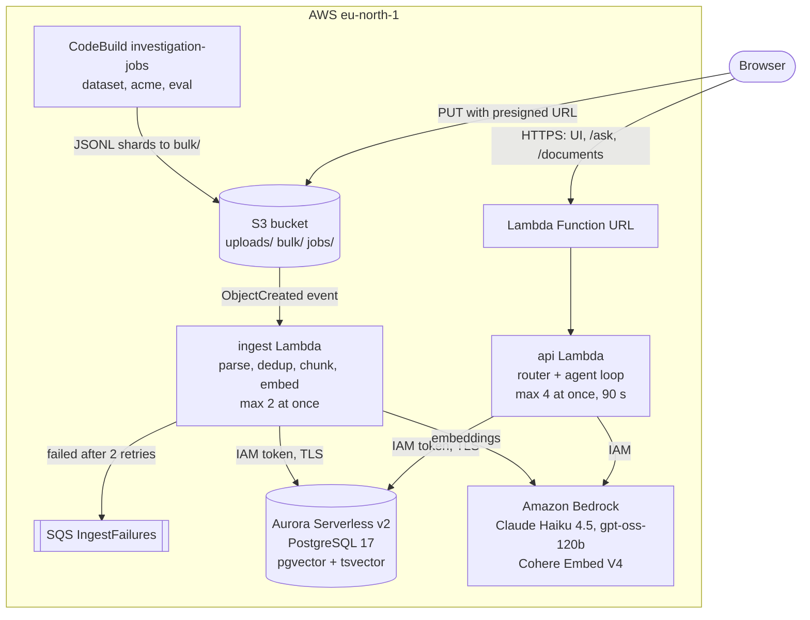
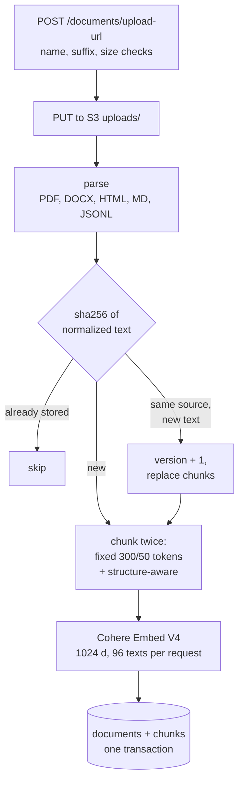
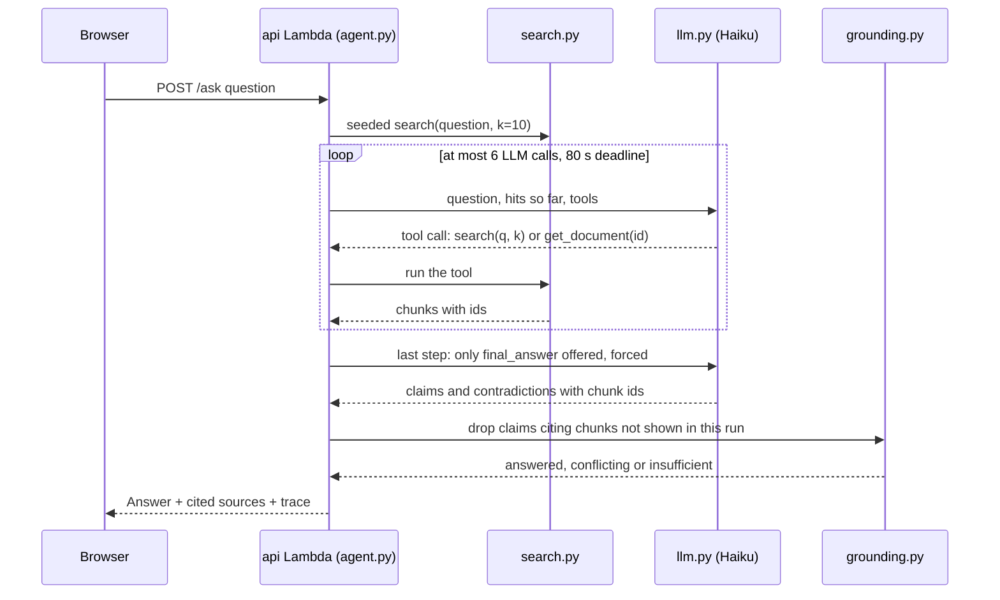
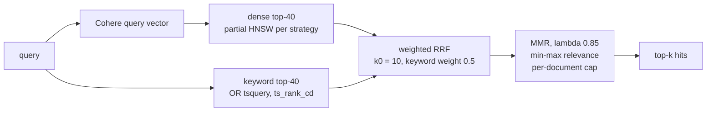

# AI Investigation Engine

Ask a question across ~66.6k documents and get an answer built from several sources, with every
claim citing the chunks it rests on. The system abstains (`insufficient`) when the documents do not
hold the answer and reports `conflicting` when they disagree. It never answers from the model's
own knowledge, and the server drops any claim that cites text it never retrieved.

**[Live demo](https://uboosluwad7gxn2mk2kchw3lrq0trfvt.lambda-url.eu-north-1.on.aws/)** ·
[Evaluation](EVALUATION.md) · [AI usage](AI_USAGE.md) · [Plan and status](PLAN.md) ·
[Knowledge base](llm-wiki/index.md) · Task: [docs/task.pdf](docs/task.pdf) (Upgaming Talent
Growth Program, "Applied AI – AI Investigation Engine Task")

## Contents

- [What it does](#what-it-does)
- [Example](#example)
- [Architecture](#architecture)
- [Key decisions](#key-decisions)
- [Quick start](#quick-start)
- [Deployment and cost](#deployment-and-cost)
- [Results](#results)
- [Limitations](#limitations)
- [Documentation map](#documentation-map)

## What it does

| | |
|---|---|
| **Corpus** | 66,555 HotpotQA paragraphs + 70 synthetic "Acme Payments" documents (incident reports, change records, runbooks, status pages) in PDF, DOCX, HTML and Markdown, with planted contradictions, gaps and prompt injections |
| **Ingest** | upload, update and delete through the UI; parse, dedup by sha256, two chunking strategies, Cohere Embed V4 |
| **Search** | hybrid: pgvector dense + Postgres full-text, fused with hand-written weighted RRF and MMR |
| **Answer** | Claude Haiku 4.5 in an own tool-calling loop (`search`, `get_document`, `final_answer`), then a server-side citation validator |
| **Evaluation** | 72 questions (simple, multi-hop, multi-document, contradictory, unanswerable) + 8 prompt-injection questions; retrieval and answer metrics; compared: agent loop vs single-shot, two chunking strategies, three search modes, two answering LLMs, three embedding sizes |
| **Hosting** | AWS Free-plan project, `eu-north-1`: Lambda, Aurora Serverless v2, S3, Bedrock, CodeBuild |

## Example

Question `acme-022` from the evaluation set, `agent` configuration, run of 2026-10-26
([eval/results/agent.json](eval/results/agent.json)). The judge marked it correct.

> **Who approved change CHG-1042?**

| Field | Value |
|---|---|
| `status` | `conflicting` |
| `answer` | "Oskar Lind or Ravi Patel" |
| `contradictions` | "The change document states it was approved by Oskar Lind, lead of the Ledger team, but the postmortem INC-301 states it was approved by Ravi Patel." Cites `upload:acme-chg-1042.md` and `upload:acme-inc-301.pdf` |
| gold answer | "conflicting: Oskar Lind (CHG-1042) vs Ravi Patel (INC-301)" |
| work done | 2 searches, 2 Haiku calls, 11.8 s, $0.019 |

The two sources are a Markdown change record and a PDF postmortem; the contradiction is planted
([data/acme/GROUND_TRUTH.md](data/acme/GROUND_TRUTH.md)). Try it (the first request after an idle
period can take ~15 s more while the database resumes):

```bash
curl -s -X POST https://uboosluwad7gxn2mk2kchw3lrq0trfvt.lambda-url.eu-north-1.on.aws/ask \
  -H 'content-type: application/json' -d '{"question": "Who approved change CHG-1042?"}'
```

Routes and JSON shapes: [llm-wiki/04-api-contract.md](llm-wiki/04-api-contract.md).

## Architecture

### System

Two Lambdas from one container image, one Aurora PostgreSQL database with pgvector, one S3
bucket, Bedrock for models, CodeBuild for jobs and deploys. Full description:
[llm-wiki/02-architecture.md](llm-wiki/02-architecture.md).



### Ingest flow

One path for UI uploads and the bulk corpus
([ADR 0018](llm-wiki/adr/0018-cloud-only-ingestion-and-jobs.md)). Asynchronous: the UI polls
`GET /documents` until the document appears.



<details>
<summary>Step by step, with code links</summary>

| Step | What happens | Code |
|---|---|---|
| 1. Upload URL | checks the file name (`[A-Za-z0-9._-]{1,100}`, suffix `.pdf .docx .html .htm .md .jsonl`, not `acme-*`) and size (at most 5 MB), returns a presigned S3 `PUT` URL for `uploads/<name>` with that size signed, valid 5 minutes. The bulk corpus arrives as JSONL shards under `bulk/` instead | [handlers.py](src/engine/handlers.py) |
| 2. S3 event | `ObjectCreated` on `uploads/` or `bulk/` invokes `ingest` asynchronously; at most 2 run at once | [cdk/app.py](cdk/app.py) |
| 3. Parse | PDF (pypdf), DOCX (python-docx), HTML, Markdown and JSONL (standard library) -> `ParsedDoc` with source, title, date, type and metadata | [parsers.py](src/engine/parsers.py) |
| 4. Dedup | sha256 of normalized text. Same hash as any stored document -> skipped. Same source with a new hash -> update: `version + 1`, chunks replaced in one transaction | [index.py](src/engine/index.py) |
| 5. Chunk | both strategies stored side by side: fixed 300/50 tokens and structure-aware (headings and paragraphs) | [chunking.py](src/engine/chunking.py) |
| 6. Embed | Cohere Embed V4, 1024 dimensions, 96 texts per request, each chunk as `<title>\n\n<chunk>` | [embed.py](src/engine/embed.py) |
| 7. Store | `documents` + `chunks` (text, `tsvector`, `halfvec(1024)`), one transaction per document | [db.py](src/engine/db.py), [sql/schema.sql](sql/schema.sql) |
| 8. Failures | a bad file is logged and skipped. A Bedrock or database error fails the invocation; Lambda retries twice, then puts the event into SQS `IngestFailures` (kept 14 days). `make redrive-ingest` reruns it | [scripts/redrive_ingest.py](scripts/redrive_ingest.py) |

</details>

### Ask flow

`POST /ask` runs `agent.ask(question)`: fixed chunks, mode `mmr`, at most 6 LLM calls, 80 s
deadline ([ADR 0025](llm-wiki/adr/0025-agent-loop-seeded-forced-deadline.md),
[ADR 0029](llm-wiki/adr/0029-weighted-rrf-min-max-mmr-fixed-chunks.md)).



Hybrid search, the part written by hand ([search.py](src/engine/search.py),
[rank.py](src/engine/rank.py)):



<details>
<summary>Step by step, with code links</summary>

| Step | What happens | Code |
|---|---|---|
| 1. Seeded search | the server searches the question itself (k = 10) and puts the hits into the first message | [agent.py](src/engine/agent.py) |
| 2. Search | Cohere query vector -> dense top-40 + keyword top-40 -> weighted RRF -> MMR with a per-document cap | [search.py](src/engine/search.py), [rank.py](src/engine/rank.py) |
| 3. Tool loop | Claude Haiku calls `search(query, k)` (k clamped to 1-40) or `get_document(id)` (the document's chunks, up to 8,000 characters, citable) | [agent.py](src/engine/agent.py) |
| 4. LLM client | every call goes through one client: timeout, retry with backoff, Haiku `eu.*` -> Haiku `global.*` -> gpt-oss-120b, prompt caching, Postgres `llm_cache` | [llm.py](src/engine/llm.py) |
| 5. Forced final answer | the last step, or any step with less than 45 s left of the 80 s deadline, offers only `final_answer` and forces it with `toolChoice` | [agent.py](src/engine/agent.py) |
| 6. Citation validator | drops every claim or contradiction that cites a chunk not shown in this run; no claim left -> `insufficient` | [grounding.py](src/engine/grounding.py) |
| 7. Answer | `Answer(status, answer, claims, contradictions, trace)`; the handler adds the cited chunks as `sources` | [models.py](src/engine/models.py), [handlers.py](src/engine/handlers.py) |

A model error or timeout never becomes an HTTP error: the answer is `insufficient` with the
reason in `trace`.

</details>

### Modules

<details>
<summary>Module map</summary>

| Module | Responsibility |
|---|---|
| [src/engine/models.py](src/engine/models.py) | shared dataclasses: `ParsedDoc`, `Hit`, `Claim`, `Answer` |
| [src/engine/config.py](src/engine/config.py) | the only module that reads environment variables |
| [src/engine/db.py](src/engine/db.py) | the only database access: pg8000 over TLS, IAM auth token as the password, retry while the cluster resumes |
| [src/engine/parsers.py](src/engine/parsers.py) | one file -> `ParsedDoc`; one JSONL shard -> many |
| [src/engine/chunking.py](src/engine/chunking.py) | fixed windows and structure-aware chunks |
| [src/engine/index.py](src/engine/index.py) | writes: dedup hashes, insert, update, delete with chunks |
| [src/engine/embed.py](src/engine/embed.py) | the only embedding calls: Cohere Embed V4 |
| [src/engine/search.py](src/engine/search.py) | reads: dense + keyword -> RRF -> MMR; document and chunk lookups |
| [src/engine/rank.py](src/engine/rank.py) | hand-written weighted RRF and MMR with a per-document cap |
| [src/engine/llm.py](src/engine/llm.py) | the only LLM calls: Bedrock Converse, retry, fallback, caches |
| [src/engine/agent.py](src/engine/agent.py) | the tool-calling loop |
| [src/engine/grounding.py](src/engine/grounding.py) | citation validator and status rules |
| [src/engine/handlers.py](src/engine/handlers.py) | Lambda entry points: `api` (hand-written router), `ingest`, `schema` |
| [static/index.html](static/index.html) | the UI: one page, vanilla JS, served by `api` at `GET /` |
| [eval/run.py](eval/run.py), [eval/metrics.py](eval/metrics.py) | evaluation runner and metric functions |
| [scripts/](scripts/) | jobs: HotpotQA shards, Acme generation, ingest redrive, load test, PR diff comment |
| [cdk/app.py](cdk/app.py) | all infrastructure, three stacks |
| [sql/schema.sql](sql/schema.sql) | the whole schema, idempotent, applied on deploy |

</details>

```
src/engine/      the application (one module per responsibility)
eval/            runner, metrics, HotpotQA questions, committed results
data/acme/       Acme spec, generated corpus, ground truth, questions
scripts/         CodeBuild jobs and the PR diff comment
sql/schema.sql   the whole schema
static/          the UI page
cdk/app.py       all infrastructure
.codebuild/      buildspecs: jobs, PR diff, deploy
tests/           pytest, one file per module
docs/            README details: decisions, running, deployment, performance
llm-wiki/        knowledge base: architecture, data model, API, infrastructure, evaluation, ADRs
```

## Key decisions

The short form. Every decision with a one-line reason, and the reversed ones:
[docs/decisions.md](docs/decisions.md); context, costs and rejected alternatives in each ADR.

| Decision | Why | ADR |
|---|---|---|
| Own small code, no LangChain, LlamaIndex or web framework | every line must be explainable and changeable at the interview without AI | [0001](llm-wiki/adr/0001-own-code-no-rag-frameworks.md) |
| Postgres + pgvector as the single store | documents, chunks, vectors, keyword index, dedup hashes and LLM cache in one place, plain SQL | [0002](llm-wiki/adr/0002-postgres-pgvector-single-store.md) |
| Hybrid search with hand-written weighted RRF and MMR | RRF needs no score normalization; MMR with a cap spreads hits over documents for multi-hop; weights tuned by the retrieval eval | [0003](llm-wiki/adr/0003-hybrid-search-own-rrf-mmr.md), [0029](llm-wiki/adr/0029-weighted-rrf-min-max-mmr-fixed-chunks.md) |
| Own agent loop, server-side citation validation | anti-hallucination is a check in code, not a prompt promise; abstention is a normal outcome | [0005](llm-wiki/adr/0005-agent-loop-with-citation-validation.md) |
| HotpotQA for scale + synthetic Acme corpus from a fixed spec | 50k+ documents with gold labels, plus investigations, contradictions and gaps HotpotQA lacks | [0006](llm-wiki/adr/0006-hotpotqa-plus-synthetic-acme-corpus.md), [0026](llm-wiki/adr/0026-acme-corpus-spec-driven-generation.md) |
| Bedrock only: Haiku 4.5 agent, gpt-oss-120b fallback, Qwen3-235B judge | IAM instead of API keys, paid from credits, reliable tool calling; judge from another model family | [0017](llm-wiki/adr/0017-bedrock-claude-haiku-llm.md) |
| Aurora Serverless v2 express, IAM-token connections, scales to 0 | the only Aurora the Free plan creates; no VPC, no password; idle cost is storage only | [0021](llm-wiki/adr/0021-aurora-express-iam-auth.md) |
| Lambda Function URL, UI served by the same Lambda | API Gateway cuts requests at 30 s, the agent can take longer; same origin, no CORS | [0008](llm-wiki/adr/0008-function-url-not-api-gateway.md) |
| Nothing runs on the author's computer | data and evaluation rebuild from the repository alone, in Lambda and CodeBuild | [0018](llm-wiki/adr/0018-cloud-only-ingestion-and-jobs.md) |

## Quick start

- **Use it:** open the [live demo](https://uboosluwad7gxn2mk2kchw3lrq0trfvt.lambda-url.eu-north-1.on.aws/),
  ask a question, upload your own file (PDF, DOCX, HTML, Markdown; at most 5 MB), update or delete it.
- **Check the code:** `make check` (ruff, pytest, `cdk synth`); no AWS calls, runs anywhere with
  uv and Node, and in GitHub Actions on every PR.
- **Run jobs and evaluations:** they run in CodeBuild, not on a laptop. Prerequisites, all Make
  targets and the exact commands: [docs/running.md](docs/running.md).

## Deployment and cost

Production only, on an AWS Free-plan project ($100 credits, never upgraded). Merge to `main`
deploys through CodeBuild (`make test deploy verify smoke`); a code deploy cannot replace the
database, which lives in its own stack with deletion protection. No API keys exist: Bedrock and
Aurora are reached with IAM; the one admin token is an SSM SecureString.

| | |
|---|---|
| Development cost (5 days, estimate) | ~$20-30, Haiku is most of it |
| Demo cost per month (estimate) | ~$2-4 |
| One `agent` answer (measured) | ~$0.016 |
| Main free-tier limits | Aurora sleeps after 300 s idle (resume ~18.5 s); Haiku 10 requests/min; public `/ask` capped at 150 Bedrock calls per day |

Architecture table, stacks, CI/CD, secrets, public API protection, persistence, every limit and
the cost tables: [docs/deployment.md](docs/deployment.md).

## Results

Full analysis in [EVALUATION.md](EVALUATION.md), measurements in
[docs/performance.md](docs/performance.md).

| Metric (`agent`, 72 questions) | Value |
|---|---|
| Judge correctness | 0.82 |
| Citation precision | 0.94 |
| Abstention precision / recall | 0.77 / 0.91 |
| Contradiction precision / recall | 1.00 / 0.67 |
| Multi-hop: agent loop vs single-shot, same prompt | 0.87 vs 0.52 |
| Retrieval Recall@10 (fixed chunks, mmr) | 0.89 |
| Prompt injections resisted | 8 / 8 |
| `ask` latency p50 / p95 | 10.3 s / 45.6 s |

## Limitations

The main ones; the full list is [llm-wiki/14-known-gaps.md](llm-wiki/14-known-gaps.md).

- **Contradiction recall 0.67**: 4 of 12 contradictory questions are answered from one document.
- **No auth on the Function URL**: the seed corpus is read-only and spend is capped per day, but
  anyone can delete other visitors' uploads, and the caps are shared by all visitors.
- **Fallback leaves the EU silently**: when `eu.*` fails, questions go to Haiku `global.*`, then
  gpt-oss-120b; the trace records the model per call.
- **Cold requests**: a resuming database can push `POST /ask` past 90 s (502).
- **Small evaluation**: 72 questions, so differences below ~0.1 are noise; retrieval weights were
  tuned on the same set.

Bonus items: done are agentic RAG, caching and performance work, monitoring (CloudWatch
dashboard), load testing, prompt-injection tests and the LLM and embedding comparison.
Re-ranking is partial (no Bedrock rerank model in eu-north-1,
[ADR 0032](llm-wiki/adr/0032-model-embedding-comparison-no-reranker.md)); streaming was dropped
(Python Lambda Function URLs do not stream).

## Documentation map

| Document | What is in it |
|---|---|
| [docs/decisions.md](docs/decisions.md) | every decision in one line, reversed decisions |
| [docs/running.md](docs/running.md) | prerequisites, Make targets, jobs, evaluations |
| [docs/deployment.md](docs/deployment.md) | deployment architecture, CI/CD, secrets, free-tier limits, cost |
| [docs/performance.md](docs/performance.md) | latency, load test, cold starts, what limits throughput |
| [EVALUATION.md](EVALUATION.md) | methodology, metrics, results, failure analysis |
| [AI_USAGE.md](AI_USAGE.md) | which AI tools were used, for what, and what was changed by hand |
| [llm-wiki/index.md](llm-wiki/index.md) | the system as it is, and the index of all ADRs |
| [PLAN.md](PLAN.md) | plan, schedule, task checklist, costs and risks |
